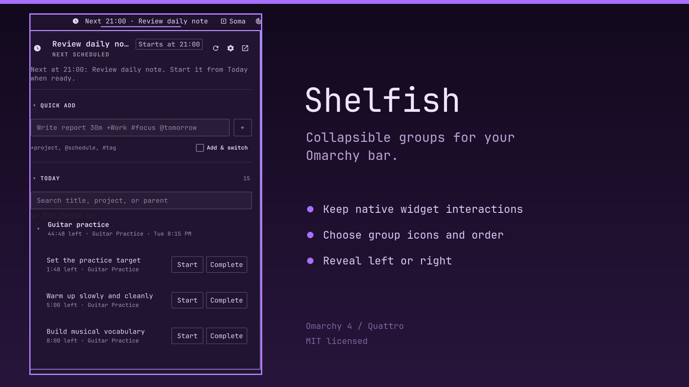

# Shelfish

<picture>
  <source media="(prefers-color-scheme: dark)" srcset="docs/brand/lockup.svg">
  
</picture>

[SUBCULT](https://subcult.tv) · [Support on Patreon](https://patreon.com/subcult)

Shelfish is an [Omarchy](https://github.com/basecamp/omarchy) bar plugin that puts your existing bar widgets on shelves: named groups that stay collapsed behind one icon until you open them. It is for Omarchy users whose top bar has more widgets than room. Each widget keeps its normal popup and clicks.

Version 1.1.1 is the latest tagged release. Shelfish depends on an internal Omarchy shell API (`moduleSlots`) that can change between Omarchy releases, and it cannot put widgets back in the exact positions they had before you grouped them.



## Features

- Named, ordered groups of installed bar widgets, each with its own icon and opening direction (left or right).
- One icon button per group in the bar, plus a settings button. Click a group icon to open it, click again to close it, right-click to open settings, middle-click to close all groups.
- A settings panel to create groups, add widgets, and reorder groups and members with Up and Down.
- A `Shelfish settings` shortcut you can add to any group to put a second settings icon beside it.
- Reveal on status: a group opens for a few seconds when a watched member's status changes. You can turn this off or change the duration per widget.
- Only the open group's widgets are loaded into the bar layout. Closed groups keep their members' settings, so hidden widgets are not loaded on every monitor.
- Restore command that removes every generated group entry and makes all grouped widgets visible again.
- Interface in English, German, Spanish, French, Italian, Brazilian Portuguese, Dutch, Polish, Croatian and Simplified Chinese, picked from the shell locale with English as the fallback. The plugin name, description and advanced settings labels stay in English because Omarchy manifests cannot be localized.
- No network access, no elevated privileges and no third-party runtime dependencies.

## Quick start

Requirements: Omarchy 4 with the Quattro shell, and `python3` (Shelfish saves the bar layout through its bundled Python helper).

Install and enable the plugin:

```sh
omarchy plugin add https://github.com/subculture-collective/omarchy-plugin-shelfish.git --enable
```

If the Shelfish widget does not appear, add it through Omarchy's bar settings. Then:

1. Select the sliders icon to open Shelfish settings.
2. Create or select a group.
3. Set its name, icon and direction.
4. Add installed bar plugins from the available plugins list.
5. Use Up and Down to order groups and members.

### Commands

The plugin registers an IPC target named `io.github.patrickfanella.shelfish`:

| Command | Effect |
| --- | --- |
| `manage` | Open Shelfish settings. |
| `show`, `hide`, `toggle` | Open the active group (or the first group), close all groups, or switch between the two. |
| `toggleGroup <id>`, `showGroup <id>` | Toggle or show one group. |
| `status` | Print the current state as JSON. |
| `restoreAll` (alias `restore`) | Remove generated group entries and show every grouped widget. Prints `ok` or `failed`. |

Example:

```sh
omarchy-shell io.github.patrickfanella.shelfish status
```

### Remove

Restore first, then remove the plugin straight away:

```sh
omarchy-shell io.github.patrickfanella.shelfish restoreAll
omarchy plugin remove io.github.patrickfanella.shelfish
```

Restore makes every grouped widget visible again but does not put it back in its original position.

## Configuration

Most people only need the settings panel. Shelfish stores everything on its own entry in `~/.config/omarchy/shell.json`. The advanced keys are:

| Key | Default | Purpose |
| --- | --- | --- |
| `groups` | one empty group named `Shelfish` | JSON list of groups: `id`, `name`, `icon`, `direction` and `widgets`. |
| `activeGroupId` | `default` | The open group, or empty when all groups are closed. |
| `watchedPaths` | empty | Status rules in the form `plugin.id=path\|nested.path;other.id=count`. |
| `policies` | `{}` | JSON keyed by widget ID. Each value may set `autoReveal` and `revealSeconds`. |
| `revealSeconds` | `8` | How long a group stays open after a status change, from 1 to 300 seconds. |

Besides `watchedPaths`, Shelfish reads explicit `shelfishStatus` and legacy `omatenderStatus` properties on member widgets. It does not guess status from other widget internals. Status snapshots accept only `null`, booleans, finite numbers and strings; Shelfish limits path count and depth, truncates strings and caps the size of each snapshot. Member status is polled every 500 ms.

### How layout changes work

Omarchy Quattro only lets `bar`-kind plugins call `mutateShellConfig`, so Shelfish saves through `apply-layout.py`. The helper writes the settings to the Shelfish entry, places the open group's members next to its group button, and replaces `shell.json` atomically. Groups follow the order in settings, and members follow their order inside each group. A right-facing group is laid out as `group icon, members`; a left-facing group as `members, group icon`.

Closed groups keep their members' full entries, including duplicate instances, in `widgetConfigs`. Opening or closing a group saves the layout and the bar rebuilds. Missing entries are skipped. A widget can belong to only one group, and the native `omarchy.tray` entry cannot be grouped.

If Shelfish finds no usable module slots, widgets stay visible, saved groups are kept, and the settings panel shows a compatibility message. Grouping resumes when slot discovery works again.

## Security

Omarchy plugins run unsandboxed. Shelfish edits `~/.config/omarchy/shell.json` by running its bundled `apply-layout.py` with `python3`. It does not use the network or ask for elevated privileges.

## Known limitations

- Depends on Quickshell's Wayland window scene graph and the shell's internal `moduleSlots` API.
- Groups only installed bar plugins that have live module slots and registered entries in `shell.json`.
- Cannot restore pre-group layout positions.

## Release

Omarchy installs the plugin from its Git repository, so there is no build step. Releases are Git tags (`v1.0.0` through `v1.1.1`); [CHANGELOG.md](CHANGELOG.md) lists the changes and [PUBLISHING.md](PUBLISHING.md) has the release checklist. Marketplace submission is planned but has not been made.

## Project layout

| Path | Contents |
| --- | --- |
| `manifest.json` | Plugin ID, entry points and settings schema. |
| `Service.qml` | Shared service: groups, status polling, reveal timers and IPC. |
| `BarWidget.qml`, `GroupButton.qml`, `SettingsButton.qml` | Bar buttons. |
| `ManagePanel.qml` | Settings panel. |
| `Model.js`, `SharedService.js`, `I18n.js` | Group model, shared service lookup and translations. |
| `apply-layout.py` | Writes the bar layout to `shell.json`. |
| `tests/` | Node tests and `check-all.sh`. |

## Contributing

Report bugs and request features in [GitHub issues](https://github.com/subculture-collective/omarchy-plugin-shelfish/issues). Send code as pull requests on GitHub against `main`. CI runs `tests/check-all.sh` (model, localization, scoped shell and release tests) on every pull request. Run the same checks locally:

```sh
tests/check-all.sh
omarchy plugin validate .
```

`check-all.sh` also runs `omarchy plugin validate .` when the `omarchy` CLI is installed. Standalone `qmllint` cannot resolve every Quickshell runtime type, so test QML changes in a live shell as well.

## License

[MIT](LICENSE). Copyright Patrick Fanella. Made as part of [SUBCULT](https://subcult.tv).
